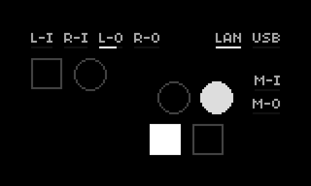

# shield

check your shieldXL's ins and outs.



shield shows activity on every input and output of a [shieldXL](https://github.com/okyeron/shieldXL) (okyeron's norns shield with 1/4" audio jacks and TRS MIDI): the audio jacks, the network, USB, the MIDI jacks, the keys and the encoders, each placed on the screen where it is on the unit. it's meant for anyone who has just built one: plug something in and see right away whether it arrives, and where.

## requirements

- a shieldXL with norns (made on a Raspberry Pi 4, norns 2.9.4)
- for M-I / M-O: the shieldXL's TRS MIDI jacks set up as norns' `virtual` MIDI device (okyeron's MIDI setup, or `04-midi.sh` in [shieldxl-trixie](https://github.com/loopmasta/shieldxl-trixie))

## documentation

every label has a thin bar under it that shows its activity.

| label | what | the bar |
|---|---|---|
| `L-I` `R-I` | audio inputs, left / right | the level (−60 to 0 dB) |
| `L-O` `R-O` | audio outputs, left / right | the level |
| `LAN` / `WLAN` | network, by cable or wireless (`NET` when there's none) | full while connected |
| `USB` | USB MIDI devices, grid, arc, keyboards, gamepads | flashes on every event |
| `M-I` | MIDI in (the TRS jack) | flashes on every message |
| `M-O` | MIDI out (the TRS jack) | flashes on every message sent |

the labels sit roughly where their jacks are on the shieldXL: the audio jacks along the back edge (inputs left, outputs right), network and USB at the back right in the order of the Pi's ports (a Pi 4 has Ethernet left of USB, a Pi 3 the other way round; shield finds out which Pi it runs on), the MIDI jacks on the right side.

### keys and encoders

the squares are the keys, the circles the encoders, placed as on the unit: K1 and E1 top left, E2 and E3 above K2 and K3. a key fills while you hold it, an encoder fills while you turn it.

K1: norns keeps a short press for its menu, so K1 only shows when you hold it.

### tests

| control | action |
|---|---|
| hold K2 (1 s) | a test tone on the left output, then on the right: shows which output jack is which |
| hold K3 (1 s) | C E G C on MIDI channel 1 out of the MIDI OUT jack |

### troubleshooting

- **nothing on `L-I` / `R-I`:** check the input level in norns' LEVELS menu and the cable.
- **`M-I` stays dark:** is the cable in MIDI IN (not OUT)? does the device send MIDI on its TRS jack? the shieldXL's red LED lights when MIDI comes in.
- **a device doesn't react to the K3 test:** check the device's MIDI channel first (the test sends on channel 1); the shieldXL's blue LED flickers while MIDI goes out. then check the MIDI OUT Type A / B switch on the shieldXL's main board.
- **`USB` stays dark with a USB stick or audio interface:** shield only sees devices that send events to norns (MIDI, grid, arc, keyboards, gamepads), not raw USB traffic.

## install

```
;install https://github.com/loopmasta/shield
```

or copy `shield.lua` and `lib/` to `dust/code/shield/`.

shield brings a tiny SuperCollider engine (`lib/Engine_Shield.sc`) for the test tone. after installing, **restart norns once** (SYSTEM > RESTART), so SuperCollider picks it up.
